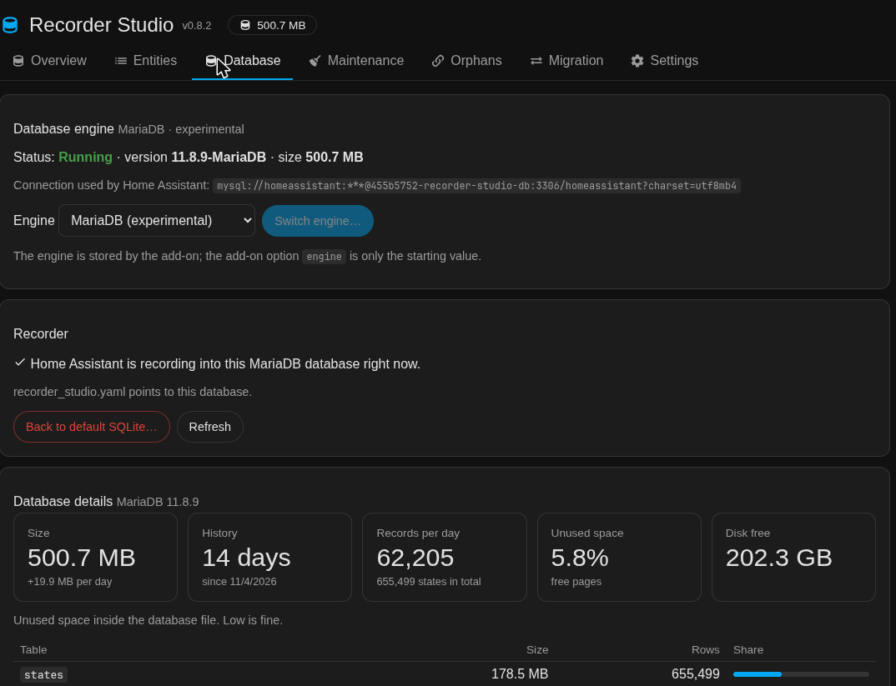
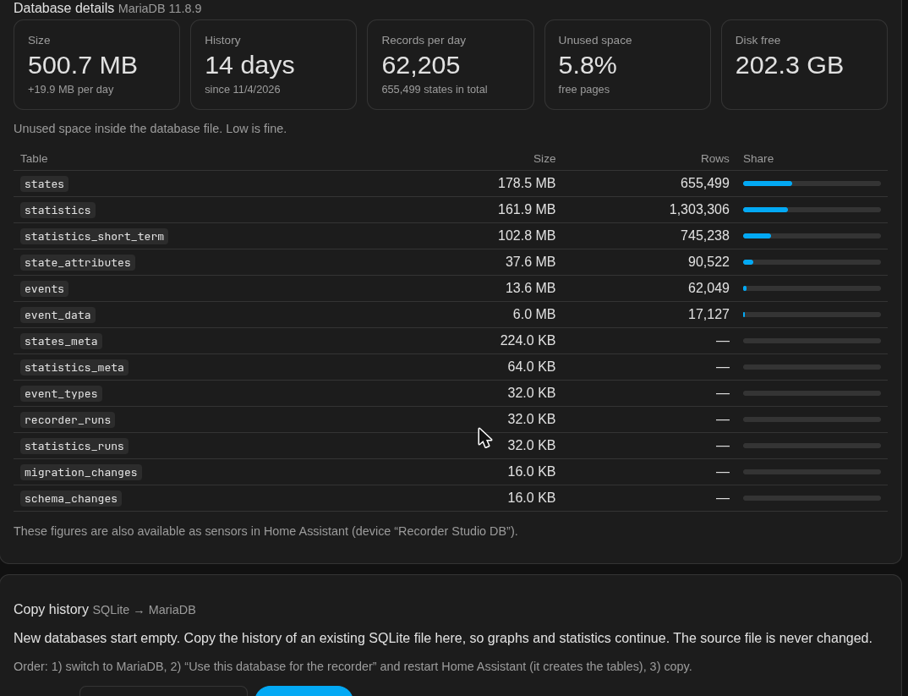
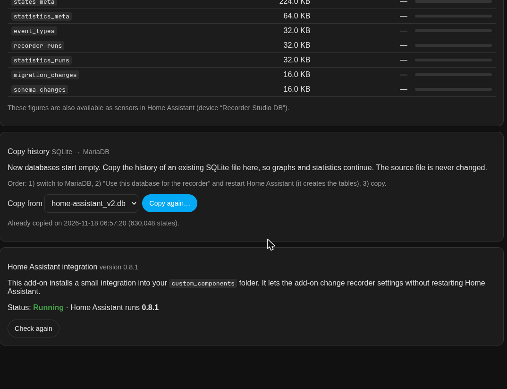
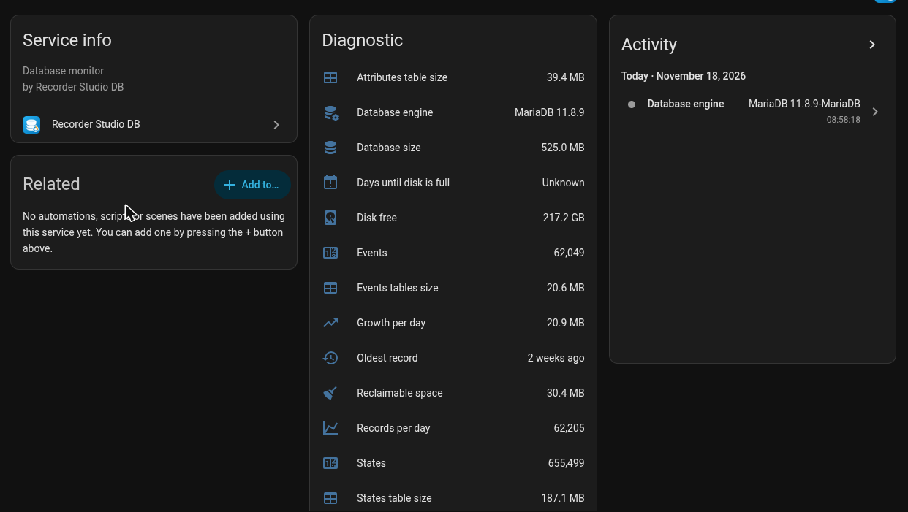

# Recorder Studio DB

[](https://my.home-assistant.io/redirect/supervisor_add_addon_repository/?repository_url=https%3A%2F%2Fgithub.com%2Fr3mcos3%2Frecorder-studio-db)

> **⚠️ Use at your own risk.** This add-on replaces the database your Home Assistant history lives in, and it is new software. The author is not responsible for lost or damaged data, history, statistics or anything else. **Make a full backup first**, keep your old SQLite file until you are sure everything works, and do not rely on it for anything you cannot afford to lose.

A Home Assistant **add-on** that runs the recorder database for you (SQLite, MariaDB or PostgreSQL, chosen in the panel) and has
[Recorder Studio](https://github.com/r3mcos3/recorder-studio) built in: see what fills the database, choose what is recorded,
purge and repack safely, and watch the database with sensors.



## What it does

- **Runs the database.** MariaDB or PostgreSQL inside the add-on, or Home Assistant's own SQLite file. Switch from the panel.
- **Brings your history along.** *Copy history* copies states, events and statistics of an existing SQLite file into the new
  server. The SQLite file is only read, so it stays as your backup; Home Assistant can keep recording meanwhile.
- **No restart for most changes.** Excluded entities, retention, auto purge and auto repack are applied to the running recorder.
  Only the database URL and the commit interval still need a restart.
- **No history lost when the add-on restarts.** Before the database is stopped the recorder is told to wait; it keeps its events
  in memory and writes them when the database is back.
- **Database details and sensors.** Size, growth, how far back the history goes, unused space, free disk with a forecast, and
  size and rows per table, also as 16 diagnostic sensors in Home Assistant.
- **Everything from Recorder Studio.** Per device/entity recording control, suggestions, purge and repack with an impact
  preview, alerts, import of an existing recorder configuration.
- **Keeps the password out of your YAML.** The database URL lives in `secrets.yaml`; `recorder_studio.yaml` only refers to it.







## How it works

The add-on starts the database server and writes `recorder_studio.yaml` for the recorder. Home Assistant's recorder can only be
changed from inside Home Assistant, so the add-on installs a very small integration of its own (`recorder_studio_db`) into
`custom_components` and creates its entry itself. It provides the live apply, the recorder pause and the sensors. Home Assistant
needs one restart to load it the first time.

## Install

Home Assistant > Settings > Add-ons > Add-on store > ⋮ > Repositories, add `https://github.com/r3mcos3/recorder-studio-db`
(or use the button above), then install **Recorder Studio DB**. In the **Database** tab choose the engine, wait for *Running*, press
*Use this database for the recorder* and restart Home Assistant once. Optionally copy your history. See
[DOCS](recorder_studio_db/DOCS.md) and the [changelog](recorder_studio_db/CHANGELOG.md).

## Status

New, so reports are welcome. MariaDB and PostgreSQL have both been run on a real Home Assistant with the full chain: recording,
live apply, restart of the add-on without losing history, copying a 2.8 million row history, the sensors and a repack.
Home Assistant OS / Supervised only. Live apply and the recorder pause use recorder internals (Home Assistant has no API for it); every step is guarded and falls
back to asking for a restart.

Use either this add-on **or** the [Recorder Studio integration](https://github.com/r3mcos3/recorder-studio) to manage
`recorder_studio.yaml`, not both.

## Development

```bash
python -m venv .venv && .venv/bin/pip install aiohttp pytest pytest-aiohttp pyyaml
.venv/bin/pytest
```

`recorder_studio_db/app/studio/core/` and `recorder_studio_db/app/www/` are derived from the Recorder Studio integration
(MIT, same author); the add-on talks to Home Assistant through the Supervisor API instead of Home Assistant internals.
CI also tests against real MariaDB/PostgreSQL servers, a real recorder and the container's stop sequence.

MIT licensed.
